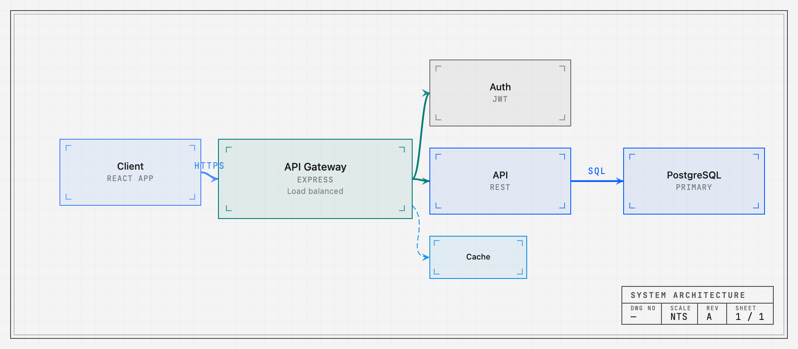
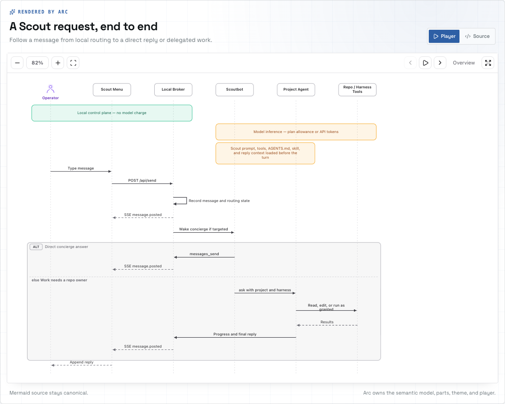
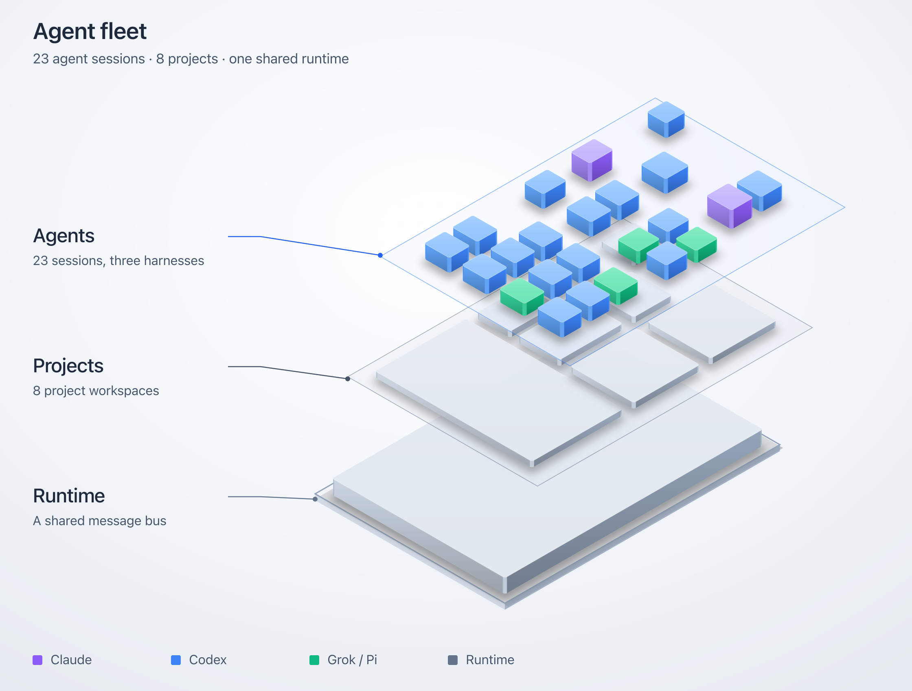
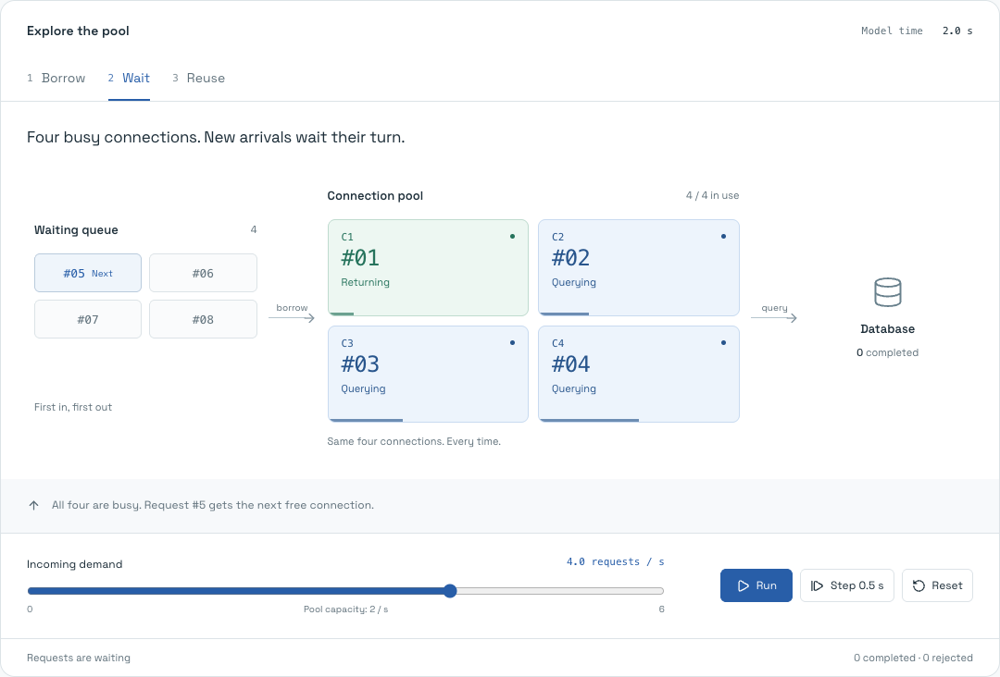

<div align="center">

<h1> Arc</h1>

### Build explanations people can explore.

**A visual explanation toolkit for software systems.**<br />
Build interactive maps, playable sequences, and spatial views with a visual
studio and developer tools. Bring them into your app or documentation.

[](https://www.npmjs.com/package/@arach/arc)
[](./LICENSE)
[](./src/types/diagram.ts)

[Explore Arc](https://arc.jdi.sh/) · [Try a live explainer](https://arc.jdi.sh/examples/connection-pool/) · [Start building](#get-started) · [Documentation](./docs/overview.md)

</div>

Trace a request, play an exchange between services, or open up the layers of
an architecture. Build an onboarding walkthrough, interactive article, or
design review that lets people explore how the system works. Author on the
canvas, in code, or with an agent, and keep the source alongside your software.

## Turn the map into a walkthrough

Start with services, databases, queues, and the connections between them. Arc
provides semantic node kinds, icons, groups, relationship styles, and automatic
layout to give the system a clear structure. Then make that structure explorable.



- **Focus on the path that matters.** Hover or select a component to reveal its
  relationships. Author a focus story with a caption and steps to explain a
  whole request path, boundary, or workflow.
- **Guide the reader through chapters.** Named views frame the relevant region
  and highlight its nodes and connections. Readers can step through the story
  or leave it to explore on their own.
- **Put requests in motion.** Send packets along multi-step routes, pause at a
  service, follow the return path, and show trails. Set timing and repeats, or
  control the exact instant with `flowTime`.

Pan, zoom, fit, minimaps, and legends keep the system navigable. Chapters,
focus stories, and animated routes are authored data that can be edited and
reviewed alongside the drawing.

[Guided views](./docs/views.md) · [Focus stories](./docs/focus-stories.md) · [Flow API](./docs/api.md) · [Source for the image](#example-output)

## Play the conversation

Arc's **native Mermaid sequence player** makes an exchange something you can
follow one message at a time. Actors, lifelines, self-calls, notes, branches,
and loops retain their place in the story. Play the sequence, step backward or
forward, focus a participant, or open it fullscreen.



Mermaid text stays the source. Arc owns the typed sequence model, layout,
SVG rendering, and playback. You can customize theme tokens and replace
individual visual parts to fit your application. Mermaid.js is not required
at runtime.

Existing Mermaid flowcharts and state diagrams have a separate import path
into Arc's architecture format.

[Native sequence guide](./docs/mermaid-sequences.md) · [Supported Mermaid imports](./docs/mermaid-import.md)

## Give the system depth

Use isometric views to make layers, boundaries, and hierarchy visible. Project
an architecture into spatial blocks, or compose a tiered scene with elevated
floors, staggered layers, translucent components, and pillars. Hover a layer
to lift it out of the stack; use node and layer callbacks to connect the view
to your application.

[](./public/agent-fleet.png)

Choose shaded solids, hatched blueprint linework, cyanotype plates, or a
retro-print material with mineral inks and deterministic stipple. The tiered
renderer has React and static SVG APIs, including a vanilla JavaScript embed.

[Isometric types and options](./src/iso/types.ts) · [Example fleet composition](./scripts/agent-fleet-iso.ts)

## Let readers operate the explanation

Turn up demand in the [connection-pool explainer](https://arc.jdi.sh/examples/connection-pool/).
All four database connections fill, and requests start waiting. Step through a
handoff to see which request gets the next connection. Stop arrivals and watch
the queue drain.

[](https://arc.jdi.sh/examples/connection-pool/)

The queue, leases, counts, and handoffs come from the same deterministic model.
This working example combines a custom mechanism view with an Arc diagram
projection. It shows how to build an explanation that responds to the reader's
actions and makes cause and effect visible.

[Operate the pool](https://arc.jdi.sh/examples/connection-pool/) · [Read the model](./src/components/explainers/connectionPoolModel.ts) · [See the Arc projection](./src/components/explainers/connectionPoolDiagram.ts)

## Create on the canvas. Refine in code.

The studio puts the drawing and its source side by side. Drag components into
place, connect their anchors, shape groups, and refine the result in the
inspector. Edit the JSON and the canvas updates. Move a node and the source
updates with it.


Multi-selection, keyboard shortcuts, undo/redo, templates, image layers,
custom dimensions, connector routing, and export crops give you control over
the finished composition. Switch between 2D and isometric editing. Save to a
file, restore a local browser session, or copy a typed module into your app.

The editor's React components, context, and hooks are available for embedding.
The player showcase lets you tune a viewer's appearance and controls, then
copy the matching JSX.

Open the studio from [Arc](https://arc.jdi.sh/), or [run it locally](#development).

## Give the drawing a visual identity

Eleven themes shape typography, node silhouettes, grids, frames, decoration,
and title blocks as well as color. Choose an engineering plate, a quiet
workbench, a tactical map, or a mission console. Every theme has light and
dark modes; individual nodes and relationships can carry their own styling.

<details>
<summary>See the same architecture in three visual languages</summary>


</details>

The themes are `default`, `warm`, `cool`, `mono`, `engineering`, `workbench`,
`tactical`, `command`, `spacex`, `claude`, and `codex`. Studio shell skins and
interface density are configurable independently of the diagram.

[Theme guide](./docs/themes.md)

## Build with agents. Review with people.

Arc gives agents a concrete authoring loop: write the document, arrange it,
check it, render it, and revise it. Typed data and a closed JSON Schema define
the format. Coded diagnostics identify problems such as dangling connections,
overlaps, and invalid routes, with suggested fixes an agent can act on.

Together, the CLI and MCP server provide validation, automatic layout, rendering, diffs,
and a handoff into the visual studio. A person can inspect the result and
refine the drawing directly.

Attach repository paths, line ranges, and commits to the nodes they describe.
Review structural changes on the diagram itself: highlight additions, ghost
removed elements, and show where components moved.

```tsx
import { ArcDiagram, diffDiagram } from '@arach/arc'

<ArcDiagram data={head} delta={diffDiagram(base, head)} />
```

That gives a code review both the changed source and a visual explanation of
the changed structure.

[Structural diffs](./docs/diff.md) · [Agent guide](./docs/agent/quickstart.agent.md) · [Authoring benchmarks](./benchmarks/README.md)

## Take the explanation where it belongs

| Destination | What you can use |
| --- | --- |
| Your product or documentation | Interactive React diagrams, sequence players, and editor components. |
| A design review | Guided views, source references, and structural diff overlays. |
| A page, document, or deck | SVG, PNG, or standalone HTML with the rendered drawing. |
| A demo or announcement | Animated SVG, GIF, or MP4 from authored flow routes. |
| A terminal or Markdown file | ASCII and Unicode diagrams. |
| An agent's workspace | CLI, MCP, schema, authoring skill, and machine-readable diagnostics. |

Flow timing is deterministic. Display an exact instant, export it as a still,
or render a repeatable sequence of frames. The studio also copies source and
creates URLs carrying diagram data; browser session links reopen work stored
in that browser.

[Export guide](./docs/exports.md)

## Get started

**Try the experience:** open [Arc](https://arc.jdi.sh/) or
[operate the connection pool](https://arc.jdi.sh/examples/connection-pool/).

**Build with React:** install the main package in a React 18 or 19 project.

```bash
npm install @arach/arc
```

Import the stylesheet once and give the diagram a container with a height.
This complete example renders a request traveling from an app through an API
to a database:

```tsx
import { ArcDiagram, type ArcDiagramData } from '@arach/arc'
import '@arach/arc/arc.css'

const diagram: ArcDiagramData = {
  layout: { width: 640, height: 240 },
  nodes: {
    app: { x: 40, y: 80, size: 'm' },
    api: { x: 250, y: 80, size: 'm' },
    db:  { x: 460, y: 80, size: 'm' },
  },
  nodeData: {
    app: { name: 'Web app', kind: 'frontend' },
    api: { name: 'API', kind: 'service' },
    db:  { name: 'Database', kind: 'database' },
  },
  connectors: [
    { id: 'request', from: 'app', to: 'api', fromAnchor: 'right', toAnchor: 'left', style: 'data' },
    { id: 'query', from: 'api', to: 'db', fromAnchor: 'right', toAnchor: 'left', style: 'data' },
  ],
  connectorStyles: {
    data: { color: 'blue', strokeWidth: 2 },
  },
  flows: [
    { id: 'load', legs: [{ id: 'request' }, { id: 'query' }], duration: 2, marker: 'packet' },
  ],
}

export function Architecture() {
  return (
    <div style={{ height: 360 }}>
      <ArcDiagram data={diagram} theme="engineering" mode="dark" defaultZoom="fit" />
    </div>
  )
}
```

Arc bundles its other runtime code and CSS. No Tailwind configuration is
required. Use `flowTime={1.25}` to inspect a specific instant, or add `views`
and `showViews` to turn the diagram into a guided walkthrough.

### Start with a Mermaid sequence

Install `@arach/arc-viewer` for the native sequence player:

```bash
npm install @arach/arc-viewer
```

```tsx
import { ArcMermaidPlayer } from '@arach/arc-viewer'

const source = `sequenceDiagram
  participant App
  participant API
  App->>API: Load architecture
  API-->>App: Typed diagram`

export function RequestStory() {
  return <ArcMermaidPlayer source={source} mode="light" />
}
```

### Connect an agent

Add the MCP server to a client that supports stdio:

```json
{
  "mcpServers": {
    "arc": {
      "command": "npx",
      "args": ["-y", "@arach/arc-mcp"]
    }
  }
}
```

The repository's server provides ten tools: validation, structural diff,
automatic layout, ASCII/SVG/PNG/animation/HTML rendering, TypeScript generation,
and editor handoff. It also serves the schema, authoring skill, and LLM guide
as resources. Packages are versioned separately; use `bun run mcp` to run the
server from this checkout, or `bun run mcp:http` for self-hosted HTTP transport.

[MCP setup and tool reference](./packages/mcp/README.md)

### Use the terminal

The CLI requires Node.js 22 or newer. Run these commands in a project with
`@arach/arc` installed:

```bash
npx arc check diagram.json --json --strict
npx arc diff base.json head.json --summary
npx arc render diagram.json --out diagram.svg
npx arc render diagram.json --out flow.mp4 --duration 4 --fps 12
npx arc schema
npx arc-ascii diagram.json --charset ascii --max-width 80
```

`arc check` reports format, semantic, and composition problems. `--strict` also
fails on warnings. Render receipts include source and output hashes.
CLI PNG rendering needs Chrome or Chromium; GIF and MP4 also need ffmpeg.
Use `ARC_CHROME` and `ARC_FFMPEG` to select executables.

## Choose your package

| Package | What it provides |
| --- | --- |
| [`@arach/arc`](https://www.npmjs.com/package/@arach/arc) | Main React renderer and editor components, themes, layout, validation, structural diffs, flow helpers, ASCII rendering, and the `arc` CLI. |
| [`@arach/arc-viewer`](https://www.npmjs.com/package/@arach/arc-viewer) | Lightweight architecture viewer, native Mermaid sequence renderer/player, and Mermaid import. |
| [`@arach/arc-iso`](https://www.npmjs.com/package/@arach/arc-iso) | Tiered isometric rendering with React and vanilla JavaScript/static SVG APIs. |
| [`@arach/arc-mcp`](https://www.npmjs.com/package/@arach/arc-mcp) | Diagram tools and resources for MCP clients. |

Architecture uses `ArcDiagramData`; native sequences use `ArcSequenceDocument`;
tiered isometric scenes use `DiagramConfig`. Each model preserves the structure
its renderer needs. Animated flow markers, guided camera framing, and visual
delta overlays currently render in 2D. The [sequence guide](./docs/mermaid-sequences.md)
and [import guide](./docs/mermaid-import.md) document supported Mermaid syntax.

## Explore the API

| Area | Reference |
| --- | --- |
| Nodes, relationships, groups, player controls, and flow timing | [Component and CLI API](./docs/api.md) |
| Ordered walkthroughs and node-triggered explanations | [Views](./docs/views.md) · [Focus stories](./docs/focus-stories.md) |
| Automatic placement and group layout | [Group layout](./docs/group-layout.md) |
| Native sequence playback and Mermaid migration | [Sequences](./docs/mermaid-sequences.md) · [Import](./docs/mermaid-import.md) |
| Tiered scenes, materials, and spatial interaction | [Isometric API](./src/iso/types.ts) |
| Visual identity and output formats | [Themes](./docs/themes.md) · [Exports](./docs/exports.md) |
| Source references, diagnostics, and change review | [Schema](./schemas/arc-diagram.schema.json) · [Diffs](./docs/diff.md) |
| Agent authoring and verification | [MCP](./packages/mcp/README.md) · [Benchmarks](./benchmarks/README.md) |

## Where we're going

We want the agents changing a system to maintain its visual explanation in the
same workflow. Arc already provides the format, source references, validation,
rendering, and structural review. Automatic impact discovery and drift
notifications are the next part of that loop.

[The agent workflow and roadmap](./docs/agentic-loop.md)

## Example output

The source of the microservices diagram in the walkthrough section:

<details>
<summary>View the full typed diagram</summary>

```typescript
const diagram: ArcDiagramData = {
  layout: { width: 850, height: 340 },
  nodes: {
    client:  { x: 40,  y: 130, size: 'm' },
    gateway: { x: 220, y: 130, size: 'l' },
    auth:    { x: 460, y: 40,  size: 'm' },
    api:     { x: 460, y: 140, size: 'm' },
    cache:   { x: 460, y: 240, size: 's' },
    db:      { x: 680, y: 140, size: 'm' },
  },
  nodeData: {
    client:  { icon: 'Monitor',  name: 'Client',      subtitle: 'React App', color: 'violet' },
    gateway: { icon: 'Server',   name: 'API Gateway', subtitle: 'Express', description: 'Load balanced', color: 'emerald' },
    auth:    { icon: 'Shield',   name: 'Auth',        subtitle: 'JWT', color: 'amber' },
    api:     { icon: 'Code',     name: 'API',         subtitle: 'REST', color: 'blue' },
    cache:   { icon: 'Zap',      name: 'Cache',       color: 'sky' },
    db:      { icon: 'Database', name: 'PostgreSQL',  subtitle: 'Primary', color: 'blue' },
  },
  connectors: [
    { from: 'client',  to: 'gateway', fromAnchor: 'right',       toAnchor: 'left', style: 'https' },
    { from: 'gateway', to: 'auth',    fromAnchor: 'right',       toAnchor: 'left', style: 'internal' },
    { from: 'gateway', to: 'api',     fromAnchor: 'right',       toAnchor: 'left', style: 'internal' },
    { from: 'gateway', to: 'cache',   fromAnchor: 'bottomRight', toAnchor: 'left', style: 'cache' },
    { from: 'api',     to: 'db',      fromAnchor: 'right',       toAnchor: 'left', style: 'sql' },
  ],
  connectorStyles: {
    https:    { color: 'violet',  strokeWidth: 2, label: 'HTTPS' },
    internal: { color: 'emerald', strokeWidth: 2 },
    cache:    { color: 'sky',     strokeWidth: 1, dashed: true },
    sql:      { color: 'blue',    strokeWidth: 2, label: 'SQL' },
  },
}
```

</details>

## Development

The repository uses Bun, React, TypeScript, and Vite.

```bash
git clone https://github.com/arach/arc
cd arc
bun install
bun dev
```

Open [localhost:5188/editor](http://localhost:5188/editor) for the studio.
The local site also includes `/showcase`, `/iso-examples`, and
`/examples/connection-pool` for exploring the players and examples.

```bash
bun run typecheck
bun test scripts
bun run visual       # compare the SVG fixtures
bun run build:site   # build the library, site, and documentation pages
```

See the [visual regression guide](./visual/README.md) for fixture updates and
optional PNG comparisons.

## License

[MIT](./LICENSE)
